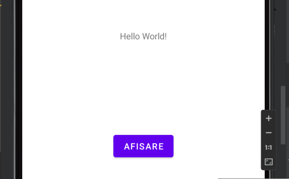
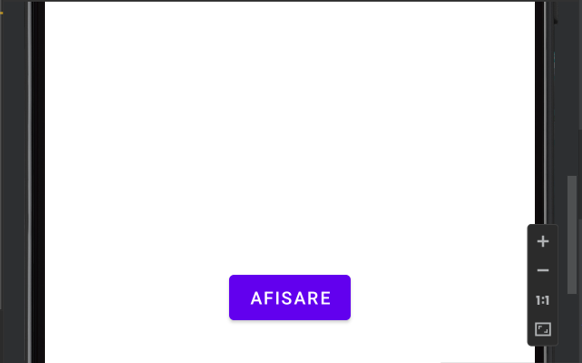

# Aplicație Android – Afișare și ascundere text

## 🇷🇴 Română

### 1. Descriere

Acest proiect constă într-o aplicație Android, dezvoltată în Java, care demonstrează modul de gestionare a evenimentelor de tip click și controlul vizibilității componentelor grafice.

Aplicația afișează un mesaj text și un buton. Prin apăsarea butonului, utilizatorul poate ascunde sau afișa din nou mesajul, în funcție de starea sa curentă.

Interfața grafică este realizată în XML, utilizând `ConstraintLayout`, `TextView` și `Button`, iar comportamentul aplicației este implementat în clasa `MainActivity.java`.

## 2. Funcționalități

- Afișarea unui mesaj text în interfața aplicației.
- Ascunderea textului prin apăsarea unui buton.
- Reafișarea textului la următoarea apăsare.
- Gestionarea evenimentelor de tip click.
- Modificarea dinamică a vizibilității componentelor grafice.

## 3. Tehnologii utilizate

- **Java** – implementarea logicii aplicației.
- **XML** – definirea interfeței grafice.
- **Android SDK** – instrumentele necesare dezvoltării aplicației Android.
- **Android Studio** – mediul de dezvoltare.
- **ConstraintLayout** – poziționarea componentelor în interfață.

## 4. Structura proiectului

```text
Aplicatie-Afisare-Text/
├── app/
│   └── src/
│       └── main/
│           ├── java/
│           │   └── com/example/myapplication/
│           │       └── MainActivity.java
│           ├── res/
│           │   ├── layout/
│           │   │   └── activity_main.xml
│           │   └── values/
│           └── AndroidManifest.xml
├── Images/
│   ├── text-vizibil.png
│   └── text-ascuns.png
├── build.gradle
├── settings.gradle
└── README.md
```

## 5. Funcționalitatea principală este implementată în `MainActivity.java`:

```java
butonAfisare.setOnClickListener(view -> {
    if (textAfisat.getVisibility() == View.VISIBLE) {
        textAfisat.setVisibility(View.INVISIBLE);
    } else {
        textAfisat.setVisibility(View.VISIBLE);
    }
});
```

### Explicația codului

- `setOnClickListener()` definește acțiunea executată la apăsarea butonului.
- `getVisibility()` verifică dacă textul este vizibil.
- `View.INVISIBLE` ascunde textul, păstrând spațiul ocupat de acesta.
- `View.VISIBLE` face textul vizibil din nou.

## 6. Capturi de ecran

Capturile de ecran prezintă cele două stări ale aplicației: text vizibil și text ascuns.

### Text vizibil



### Text ascuns



## 7. Instalare și rulare

### Cerințe preliminare

- Android Studio instalat.
- Android SDK compatibil cu proiectul.
- Un emulator Android sau un dispozitiv fizic compatibil.

### Pași de instalare

1. Clonează repository-ul:

   ```bash
   git clone https://github.com/IonutD3/Aplicatie-Afisare-Text.git
   ```

2. Deschide Android Studio.
3. Selectează opțiunea **Open** și alege directorul proiectului.
4. Așteaptă finalizarea sincronizării Gradle.
5. Pornește un emulator Android sau conectează un dispozitiv fizic.
6. Apasă butonul **Run** pentru a compila și executa aplicația.

## 8. Obiective educaționale

Prin realizarea acestui proiect sunt exersate următoarele concepte:

- Organizarea unui proiect Android.
- Utilizarea componentelor grafice `TextView` și `Button`.
- Conectarea componentelor XML la codul Java prin `findViewById()`.
- Gestionarea evenimentelor de interacțiune cu utilizatorul.
- Controlul vizibilității elementelor interfeței.

---

# Android Application – Show and Hide Text

## 🇬🇧 English

### 1. Description

This project is an Android application developed in Java that demonstrates click event handling and UI component visibility management.

The application displays a text message and a button. By clicking the button, users can hide the message or display it again, depending on its current visibility state.

The user interface is built with XML using `ConstraintLayout`, `TextView`, and `Button`, while the application logic is implemented in the `MainActivity.java` class.

## 2. Features

- Displays a text message in the application interface.
- Hides the text when the button is clicked.
- Displays the text again when the button is clicked a second time.
- Handles button click events.
- Dynamically changes the visibility of UI components.

## 3. Technologies Used

- **Java** – application logic.
- **XML** – user interface definition.
- **Android SDK** – tools required for Android application development.
- **Android Studio** – integrated development environment.
- **ConstraintLayout** – positioning UI components.

## 4. Project Structure

```text
Aplicatie-Afisare-Text/
│
├── README.md
├── build.gradle
├── gradle.properties
├── gradlew
├── gradlew.bat
├── settings.gradle
│
├── Images/
│   ├── text-vizibil.png
│   └── text-ascuns.png
│
├── gradle/
│   └── wrapper/
│       ├── gradle-wrapper.jar
│       └── gradle-wrapper.properties
│
└── app/
    │
    ├── build.gradle
    ├── proguard-rules.pro
    │
    └── src/
        └── main/
            │
            ├── AndroidManifest.xml
            │
            ├── java/
            │   └── com/
            │       └── example/
            │           └── myapplication/
            │               └── MainActivity.java
            │
            └── res/
                │
                ├── drawable/
                │   └── ic_launcher_background.xml
                │
                ├── drawable-v24/
                │   └── ic_launcher_foreground.xml
                │
                ├── layout/
                │   └── activity_main.xml
                │
                ├── mipmap-anydpi-v26/
                │   ├── ic_launcher.xml
                │   └── ic_launcher_round.xml
                │
                ├── mipmap-hdpi/
                │   ├── ic_launcher.webp
                │   └── ic_launcher_round.webp
                │
                ├── mipmap-mdpi/
                │   ├── ic_launcher.webp
                │   └── ic_launcher_round.webp
                │
                ├── mipmap-xhdpi/
                │   ├── ic_launcher.webp
                │   └── ic_launcher_round.webp
                │
                ├── mipmap-xxhdpi/
                │   ├── ic_launcher.webp
                │   └── ic_launcher_round.webp
                │
                ├── mipmap-xxxhdpi/
                │   ├── ic_launcher.webp
                │   └── ic_launcher_round.webp
                │
                ├── values/
                │   ├── colors.xml
                │   ├── strings.xml
                │   └── themes.xml
                │
                └── values-night/
                    └── themes.xml
```

## 5. The main functionality is implemented in `MainActivity.java`:

```java
butonAfisare.setOnClickListener(view -> {
    if (textAfisat.getVisibility() == View.VISIBLE) {
        textAfisat.setVisibility(View.INVISIBLE);
    } else {
        textAfisat.setVisibility(View.VISIBLE);
    }
});
```

### Code Explanation

- `setOnClickListener()` defines the action performed when the button is clicked.
- `getVisibility()` checks whether the text is currently visible.
- `View.INVISIBLE` hides the text while preserving its layout space.
- `View.VISIBLE` makes the text visible again.

## 6. Screenshots

The screenshots demonstrate the two application states: visible text and hidden text.

### Text Visible


### Text Hidden


## 7. Installation and Setup

### Requirements

- Android Studio.
- An Android SDK compatible with the project.
- An Android emulator or a compatible physical device.

### Installation Steps

1. Clone the repository:

   ```bash
   git clone https://github.com/IonutD3/Aplicatie-Afisare-Text.git
   ```

2. Open Android Studio.
3. Select **Open** and choose the project directory.
4. Wait for Gradle synchronization to finish.
5. Start an Android emulator or connect a physical device.
6. Click **Run** to build and launch the application.

## 8. Learning Objectives

This project provides practical experience with the following concepts:

- Android project organization.
- Using `TextView` and `Button` UI components.
- Connecting XML components to Java code using `findViewById()`.
- Handling user interaction events.
- Controlling the visibility of interface elements.

---

## 👤 Autor / Author

**IonutD**
